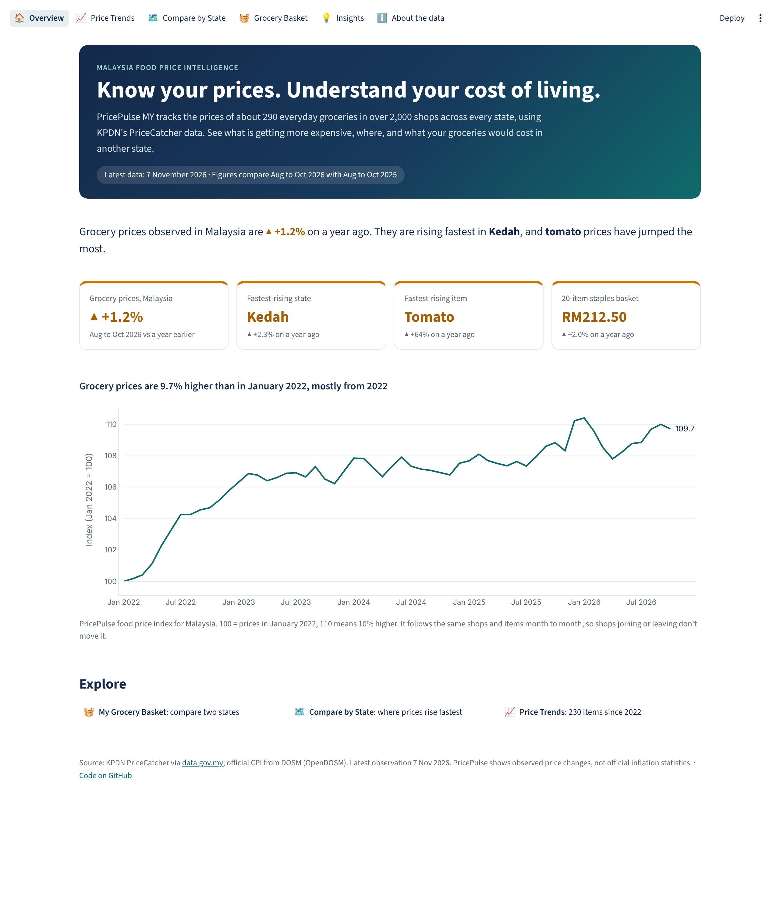

# PricePulse MY: Malaysia Food Price Intelligence

*Know your prices. Understand your cost of living.*

PricePulse MY tracks everyday food prices across Malaysia using KPDN's PriceCatcher data, published on
[data.gov.my](https://data.gov.my). It answers: how fast are observed food prices changing in each state,
which items are driving it, and how much does the same grocery basket cost from state to state?

**Live dashboard:** _add the Streamlit link here after deploying_



See [docs/PLAN.md](docs/PLAN.md).

## Quick start

```bash
python -m venv .venv && source .venv/bin/activate   # Windows: .venv\Scripts\activate
pip install -r requirements.txt
python -m src.pricepulse.fetch      # downloads ~160 MB of monthly PriceCatcher files into data/raw/
python -m src.pricepulse.clean      # one price per shop, item and month -> data/processed/ (~20 s)
python -m src.pricepulse.index      # state food price index -> data/processed/ (~1 min)
python -m src.pricepulse.drivers    # categories and items driving the change
python -m src.pricepulse.basket     # 20-item grocery basket cost by state
python -m src.pricepulse.validate   # compare with DOSM's official CPI
python -m src.pricepulse.build      # writes the small tables the dashboard reads into app/data/
pytest
# open notebooks/01_eda.py to 04_validation.py in VS Code and run the cells
streamlit run app/streamlit_app.py
```

## Dashboard
Six pages: **Overview**, **Price Trends** (230 items since 2022), **Compare by State** (map and ranking, with
what drives each state), **Grocery Basket** (the *My Grocery Basket* calculator: pick items and quantities,
choose two states, compare the cost item by item), **Insights** and **About the data**.

`app/streamlit_app.py` reads only `app/data/` (about 1.3 MB, committed), so it runs on Streamlit Community Cloud
without downloading anything. To refresh with new data: `fetch`, `clean`, `index`, `drivers`, `basket`,
`validate`, `build`, then commit `app/data/`.

### Deploy on Streamlit Community Cloud
1. Push this repo to GitHub (including `app/data/` and `.streamlit/config.toml`).
2. On share.streamlit.io choose **Create app**, pick the repo, branch `main`, main file `app/streamlit_app.py`.
3. Deploy, then paste the app link at the top of this README.

## Data sources
- PriceCatcher daily item prices by premise, KPDN via data.gov.my (`storage.data.gov.my/pricecatcher/`), Jan 2022 onwards
- PriceCatcher item and premise lookups (same location)
- Consumer Price Index by state (`cpi_2d_state`) and by expenditure class (`cpi_4d`), DOSM via OpenDOSM, used only to check our numbers
- CPI food weights, DOSM CPI Malaysia 2024 annual publication (Table 9), used to weight categories
- State boundaries, DOSM open data (`administrative_1_state.geojson`)

PricePulse reports **observed price changes** in PriceCatcher. These are not official inflation statistics;
DOSM's CPI is shown separately and labelled as such.

## Findings so far
- Observed grocery prices in Malaysia are 9.7% higher than in January 2022, mostly from 2022.
- Aug to Oct 2026 vs a year earlier: +1.2% nationally; Kedah fastest (+2.3%); prices fell in Sabah (-1.2%) and Labuan.
- States differ by only about 1.5 percentage points; beef, vegetables, onions/chilli and chicken drive the current rise.

- Vegetables drive 2026: tomatoes are up 63% on a year earlier and lead the risers in 13 of 16 states.
- A 20-item staples basket costs RM212.50 (Aug to Oct 2026); RM20.84 more in Putrajaya than in Kedah.

- Checked against DOSM's CPI: nationally the two agree closely (correlation 0.92, average gap 0.5 points).

Details: [FINDINGS_01](docs/FINDINGS_01.md) (index), [FINDINGS_02](docs/FINDINGS_02.md) (drivers), [FINDINGS_03](docs/FINDINGS_03.md) (basket), [FINDINGS_04](docs/FINDINGS_04.md) (vs DOSM CPI).
